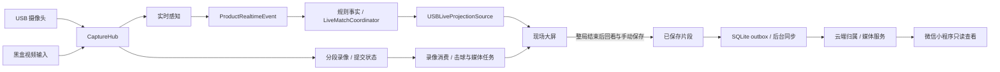

# 系统架构

产品围绕“采集原始画面 → 本地录像与感知 → 大屏赛后回看 → 用户手动保存 → 已保存片段同步”组织。录像状态与实时分析各有职责，分析失败不能被包装成录像成功。

1. **统一输入。** 摄像头和黑盒视频进入同一采集边界，复用下游运行时。
2. **录像与感知。** 分段媒体和提交状态负责可恢复的录像；模型产生的观察、事件和规则事实负责分析。
3. **现场协调。** 场次状态、逐杆事实和可视投影结合，供大屏读取；模型与 HTTP 传输职责分离。
4. **赛后保存。** 大屏在整局结束后提供回看和人工选择，只有已保存片段进入用户同步与保留路径。
5. **同步与删除。** 后台任务处理同步、回执、所有者删除与本地清理，避免把显示状态当作持久化权威。

这是代码导览图，描述产品边界和连接关系，不是本次现场验收结果。具体实现见 [源码导览](source-guide.md)。
